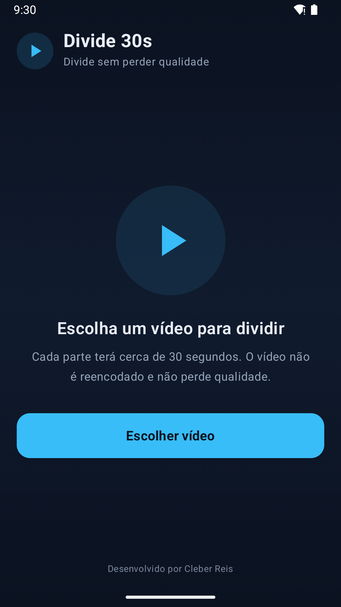
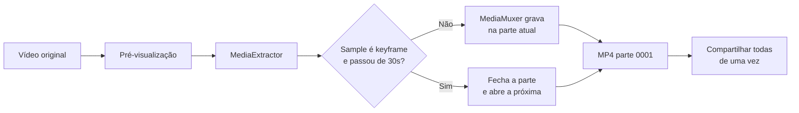

# Divide 30s

Aplicativo Android que divide vídeos em partes de **30 segundos sem reencodar**
(sem perder qualidade) e compartilha **todas as partes de uma vez** pelo WhatsApp.

[](https://github.com/clebersys/divide30s/releases)
[](LICENSE)
[](https://developer.android.com)



## Funcionalidades

- 🎬 Divide qualquer vídeo suportado pelo Android em partes de ~30s.
- 🔒 **Sem re-encode**: os samples comprimidos são copiados, a qualidade é a
  original e o processamento é rápido.
- 📤 Compartilha o grupo inteiro de uma vez (`ACTION_SEND_MULTIPLE`).
- 🟢 Atalho direto para o WhatsApp, com fallback para o seletor do sistema.
- 📄 Opção **"Enviar como documento (sem compressão)"** para o WhatsApp não
  recomprimir os vídeos.
- 📊 Progresso em tempo real e cancelamento.
- 💾 Checagem de espaço livre antes de começar.
- 🧹 Limpa automaticamente as partes da divisão anterior.
- 🌗 Interface em Jetpack Compose, tema escuro.
- 🔌 100% offline: o app **não declara a permissão `INTERNET`**.

## Como funciona



1. Ao escolher o vídeo, o app exibe uma **pré-visualização** para o usuário dar play e confirmar que é o arquivo correto.
2. O vídeo é aberto com `MediaExtractor`, que entrega os samples **já
   comprimidos** (H.264/HEVC + AAC etc.).
3. Cada sample é escrito em um `MediaMuxer` novo, sem passar por decoder/encoder.
4. Quando aparece um **keyframe** depois dos 30s, a parte atual é fechada e a
   próxima começa exatamente nesse keyframe.
5. No fim, todos os arquivos são compartilhados juntos via `FileProvider` +
   `Intent.ACTION_SEND_MULTIPLE`.

> O corte é feito no keyframe mais próximo depois dos 30s. Por isso as partes
> ficam com **30–32s** (dependendo do GOP do vídeo). Cortar no milissegundo
> exato exigiria reencodar e perderia qualidade — o que contraria o objetivo.

## Requisitos

- Android **8.0 (API 26)** ou superior.
- Para compilar: JDK 17+ e Android SDK **36** (Gradle wrapper incluso).

## Instalação

APK assinado pronto (também disponível na
[release](https://github.com/clebersys/divide30s/releases)):

```
dist/Divide30s-1.2.0-release.apk
```

Via ADB:

```bash
adb install "dist/Divide30s-1.2.0-release.apk"
```

Ou copie o APK para o celular e instale permitindo "fontes desconhecidas".

> O APK de release tem assinatura diferente do debug. Se você instalou o debug,
> desinstale antes: `adb uninstall com.cleber.videosplit30`.

## Uso

1. Abra o **Divide 30s**.
2. Toque em **Escolher vídeo** e selecione o vídeo.
3. Confira nome, duração e tamanho e toque em **Dividir em partes de 30s**.
4. Ao terminar, escolha:
   - **Compartilhar no WhatsApp** — envia todas as partes de uma vez;
   - **Enviar como documento (sem compressão)** — mantém o arquivo original
     (o WhatsApp não recomprime);
   - **Compartilhar em outro app** — abre o seletor do Android.

Guia detalhado: [docs/COMO_USAR.md](docs/COMO_USAR.md)

## Build

```bash
# debug
./gradlew assembleDebug

# release assinado (APK)
./gradlew assembleRelease

# release assinado (AAB para a Play Store)
./gradlew bundleRelease
```

Ou, para gerar tudo de uma vez e copiar para `dist/`:

```bash
./scripts/build-release.sh
```

Saídas:

- `app/build/outputs/apk/debug/app-debug.apk`
- `app/build/outputs/apk/release/app-release.apk`
- `app/build/outputs/bundle/release/app-release.aab`

### Assinatura

O release usa o keystore `keystore/divide30s-release.jks` (alias `divide30s`).
As senhas ficam em `keystore.properties`, ambos fora do Git. Para configurar do
zero, copie [`keystore.properties.example`](keystore.properties.example).

> ⚠️ Guarde o keystore **e** o `keystore.properties` em local seguro. Sem eles
> não é possível atualizar o app já instalado — só reinstalar como app novo.
> Na Play Store, este keystore atua como **upload key**.

Certificado atual (SHA-256):

```
2C:86:DC:45:A8:B4:C2:1A:F1:13:D2:62:5F:2F:CF:98:8F:67:A4:BC:09:04:7D:FE:C6:56:A1:EA:B0:5F:D4:C4
```

## Testes

Teste instrumentado que divide um vídeo real de 65s e valida quantidade,
duração, resolução e legibilidade das partes:

```bash
./gradlew connectedDebugAndroidTest
```

Resultado da última execução (emulador Android 16):

- 65s → **3 partes** (0–30s, 30–60s, 60–65s)
- todas abrem como vídeo válido, mesma resolução (320×240) e duração esperada
- soma dos tamanhos ≈ arquivo original (confirma ausência de re-encode)
- `lintDebug` e `lintRelease` sem erros

## Publicação na Play Store

O projeto já está adequado às exigências atuais da loja: `targetSdk 36`,
Android App Bundle assinado, backup desativado, sem permissões perigosas,
política de privacidade e recursos gráficos prontos.

- Passo a passo e textos da listagem: **[docs/PLAY_STORE.md](docs/PLAY_STORE.md)**
- Política de privacidade: **[PRIVACY.md](PRIVACY.md)**
- Recursos gráficos: pasta [`store/`](store)

## Estrutura

```
app/src/main/java/com/cleber/videosplit30/
├── MainActivity.kt      # UI Compose + navegação de estados
├── SplitViewModel.kt    # estado, metadados, progresso, espaço em disco
├── VideoSplitter.kt     # divisão lossless com MediaExtractor/MediaMuxer
└── ShareUtils.kt        # Intents de compartilhamento + FileProvider

app/src/androidTest/     # teste instrumentado com vídeo de amostra
app/src/main/res/xml/    # regras do FileProvider e de backup
docs/                    # arquitetura, guia de uso e publicação
scripts/                 # build de release e geração de assets
store/                   # ícone, feature graphic e screenshots da loja
```

Detalhes técnicos: [docs/ARQUITETURA.md](docs/ARQUITETURA.md)

## Limitações

- **Corte em keyframe**: partes de 30–32s, não 30,000s exatos.
- **Containers**: MP4/H.264/HEVC (padrão de celular). WebM/VP9 requer Android 10+.
- **WhatsApp**: recomprime vídeos enviados como mídia; use o modo documento para
  manter o original. O app também pode esbarrar no limite de arquivos por envio
  do WhatsApp.
- **Armazenamento**: as partes ficam na pasta privada do app
  (`Android/data/com.cleber.videosplit30/files/Movies/Divide30s/`) e não
  aparecem na galeria; são apagadas ao iniciar uma nova divisão.
- **Assinatura**: este repositório não inclui o keystore nem as senhas.

## Privacidade

O app não usa internet, não coleta dados e não envia nada para servidores. Todo o
processamento é local. O compartilhamento só acontece quando você toca em um dos
botões e escolhe o app de destino.

Texto completo: [PRIVACY.md](PRIVACY.md)

## Licença

[MIT](LICENSE) © 2026 clebersys

---

Desenvolvido por **Cleber Reis**.
