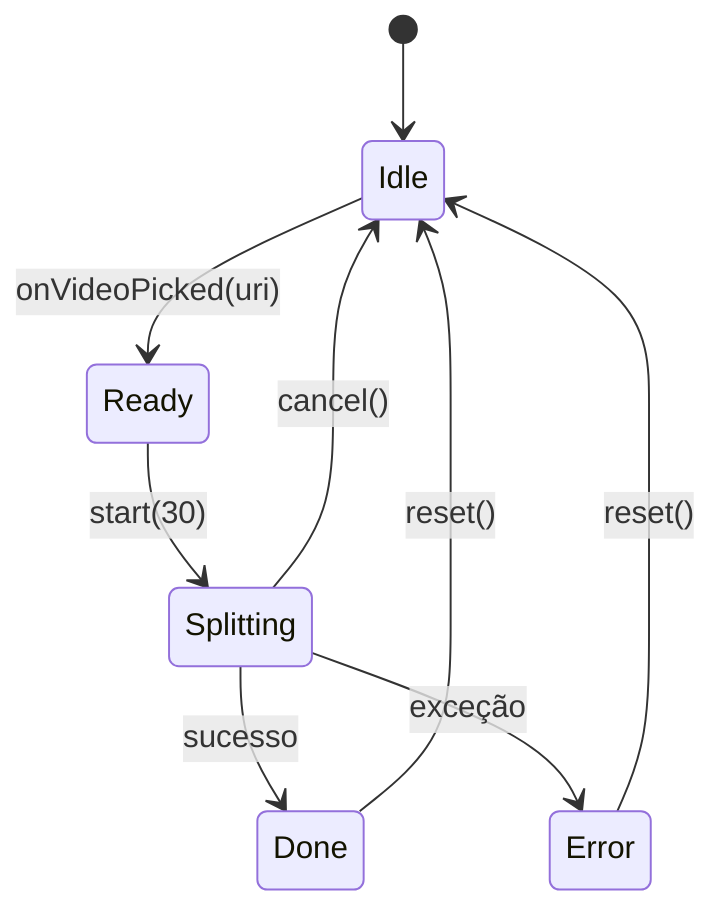

# Arquitetura técnica

## Visão geral

O app é um único módulo Android (`:app`) escrito em Kotlin com Jetpack Compose.
Não há backend, conta, internet ou biblioteca nativa de terceiros: a divisão usa
apenas APIs do sistema (`MediaExtractor`, `MediaMuxer`, `FileProvider`).

```
MainActivity (Compose)
      │  intents de seleção/compartilhamento
      ▼
SplitViewModel (AndroidViewModel)
      │  estado + metadados + tratamento de erros
      ▼
VideoSplitter (object)
      │  MediaExtractor → MediaMuxer
      ▼
Arquivos MP4/WebM em pasta privada
      │
      ▼
ShareUtils (ACTION_SEND_MULTIPLE + FileProvider)
```

## Máquina de estados

`SplitViewModel.State`:



- `Idle`: tela inicial, botão de escolher vídeo.
- `Ready`: metadados lidos (nome, duração, tamanho) e botão de dividir.
- `Splitting`: progresso `0f..1f`; a cada 64 samples o estado é atualizado.
- `Done`: lista de arquivos, MIME, duração total.
- `Error`: mensagem amigável (espaço insuficiente, vídeo inválido etc.).

A leitura de metadados e a divisão rodam em `Dispatchers.IO`; a UI nunca é
bloqueada. `checkActive` chama `coroutineContext.ensureActive()` a cada sample,
permitindo cancelamento imediato.

## Algoritmo de divisão lossless

### Por que não reencodar

Reencodar (FFmpeg, MediaCodec/Transformer) altera o vídeo, demora e pode reduzir
a qualidade. Como o objetivo é só **particionar**, é possível copiar os samples
comprimidos de um container para outro. O custo é O(n) de I/O, sem uso de CPU
para compressão.

### Passo a passo

1. `MediaExtractor.setDataSource(fd)` — abre o vídeo sem copiá-lo.
2. Seleciona a primeira faixa de vídeo e todas as faixas de áudio.
3. `seekTo(0, SEEK_TO_CLOSEST_SYNC)` garante que o primeiro sample de vídeo é
   um keyframe.
4. Para cada sample intercalado:
   - lê `sampleTrackIndex`, `sampleTime`, `sampleFlags` e os bytes;
   - se for **keyframe de vídeo** e `tempo - inícioDaParte >= 30s`, fecha o
     `MediaMuxer` atual e abre outro com `startUs = tempo` do keyframe;
   - grava o sample no muxer atual com PTS relativo (`pts - startUs`).
5. Ao acabar, fecha o último muxer e devolve os arquivos ordenados.

Pseudocódigo:

```kotlin
while (true) {
    val size = extractor.readSampleData(buffer, 0)
    if (size < 0) break

    val keyframe = track == videoTrack && flags has SAMPLE_FLAG_SYNC
    if (keyframe && timeUs - segmentStartUs >= 30_000_000L && atualTemVideo) {
        fecharParte()
        abrirParte(startUs = timeUs)
    }

    muxer.writeSampleData(track, buffer, infoComPtsRelativo)
    extractor.advance()
}
```

### Keyframes e duração das partes

O MP4 só pode ser decodificado a partir de um keyframe (I-frame). Cortar no
meio de um GOP produziria uma parte com frames que dependem de referências
ausentes. Por isso o corte acontece no primeiro keyframe após o alvo:

- GOP de 2s → partes de ~30s;
- GOP de 10s → partes de 30–40s.

Cortar em 30,000s exatos exigiria reencodar o trecho inicial de cada parte.

### Timestamps e B-frames

- O PTS de cada parte é normalizado para começar em 0 (`pts - startUs`).
- Valores negativos são limitados a 0 (situação rara de reordenação com
  B-frames na fronteira).
- Os samples são gravados na ordem de decodificação fornecida pelo
  `MediaExtractor`; o `MediaMuxer` monta `stts/stsc` corretamente.
- Flags: `SAMPLE_FLAG_SYNC` → `BUFFER_FLAG_KEY_FRAME`;
  `SAMPLE_FLAG_PARTIAL_FRAME` → `BUFFER_FLAG_PARTIAL_FRAME`. Os valores dos dois
  enums **não são iguais** — usar o flag do extractor direto no muxer corromperia
  samples marcados como criptografados.

### Rotação e formato

- `KEY_ROTATION` é lido do `MediaFormat` e aplicado com
  `muxer.setOrientationHint()` antes de `start()`.
- O container de saída é escolhido pelo MIME:
  - H.264/HEVC/MPEG-4 → `MUXER_OUTPUT_MPEG_4` (`.mp4`);
  - WebM/VP8/VP9/AV1 → `MUXER_OUTPUT_WEBM` (`.webm`, Android 10+).
- Formatos com CSD (SPS/PPS) são copiados intactos, preservando HDR/metadados
  de cor suportados pelo muxer.

### Memória e desempenho

- Buffer direto único de **16 MB** reutilizado para todos os samples; nenhum
  vídeo é carregado inteiro na memória.
- Um `MediaMuxer` por parte, fechado assim que a próxima começa.
- Sem decoder/encoder: a velocidade é limitada por leitura/escrita de disco.
- Espaço necessário ≈ tamanho do vídeo original (cópia integral).

## Armazenamento e compartilhamento

### Onde os arquivos ficam

```
getExternalFilesDir(Movies)/Divide30s/yyyyMMdd_HHmmss/parte_0001.mp4
```

Se o armazenamento externo não estiver disponível, usa
`filesDir/videos/Divide30s/...`. Ambas as raízes estão declaradas em
`res/xml/file_paths.xml`:

```xml
<external-files-path name="movies" path="Movies/" />
<files-path name="internal_videos" path="videos/" />
```

Vantagens: não exige permissão de armazenamento (scoped storage) e o
`FileProvider` concede leitura temporária ao app de destino.

### Intents

`ShareUtils.buildIntent()`:

```kotlin
Intent(Intent.ACTION_SEND_MULTIPLE).apply {
    type = if (documento) "application/octet-stream" else mimeDoVídeo
    putParcelableArrayListExtra(Intent.EXTRA_STREAM, uris)
    clipData = clipComTodasAsUris
    addFlags(FLAG_GRANT_READ_URI_PERMISSION)
}
```

- `ClipData` com todas as URIs garante a concessão de permissão para cada item.
- WhatsApp direto: tenta `com.whatsapp` e `com.whatsapp.w4b`; se não existir,
  cai no seletor padrão.
- `application/octet-stream` faz o WhatsApp tratar como documento, evitando
  recompressão.

## Decisões e alternativas descartadas

| Alternativa | Por que não |
|---|---|
| FFmpeg (`-c copy`) | FFmpegKit foi descontinuado; binários grandes (~30–100 MB), licenças e manutenção. |
| Media3 Transformer | Reencoda por padrão; transmux exigiria código extra e não traz vantagem sobre `MediaExtractor`/`MediaMuxer`. |
| MediaCodec | Reencodar perde qualidade e é lento. |
| `MediaMuxer` + `MediaExtractor` | Nativo, sem dependências, lossless, rápido e suficiente para MP4/WebM. |

## Testes

`app/src/androidTest/.../VideoSplitterTest.kt` usa um vídeo sintético de 65s
(320×240, H.264, GOP de 2s) empacotado em `assets/` e verifica:

1. exatamente 3 partes;
2. nomes ordenados;
3. todas as partes não vazias e legíveis por `MediaMetadataRetriever`;
4. mesma largura (320 px) do original;
5. soma dos tamanhos próxima do original (prova de ausência de re-encode);
6. durações das duas primeiras partes entre 28s e 32s.

O teste roda em emulador/dispositivo com:

```bash
./gradlew connectedDebugAndroidTest
```
